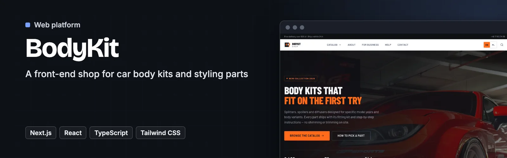
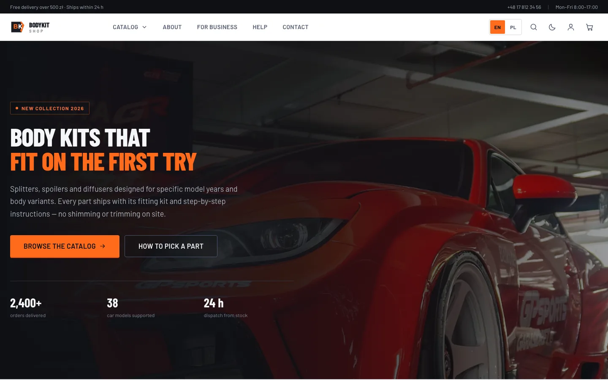
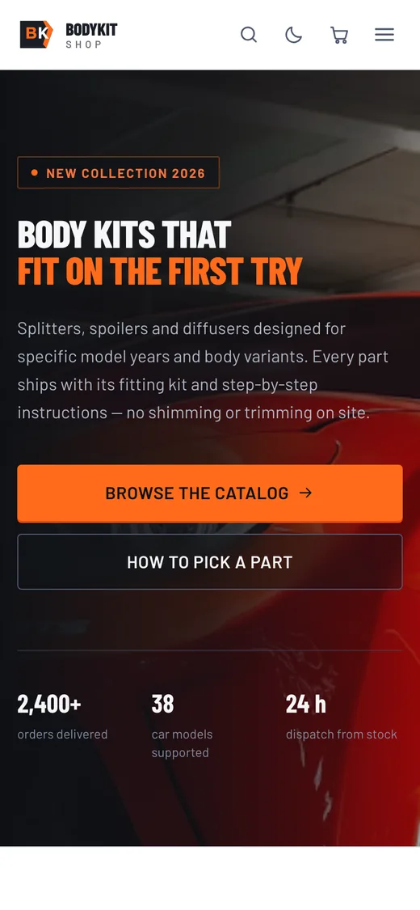
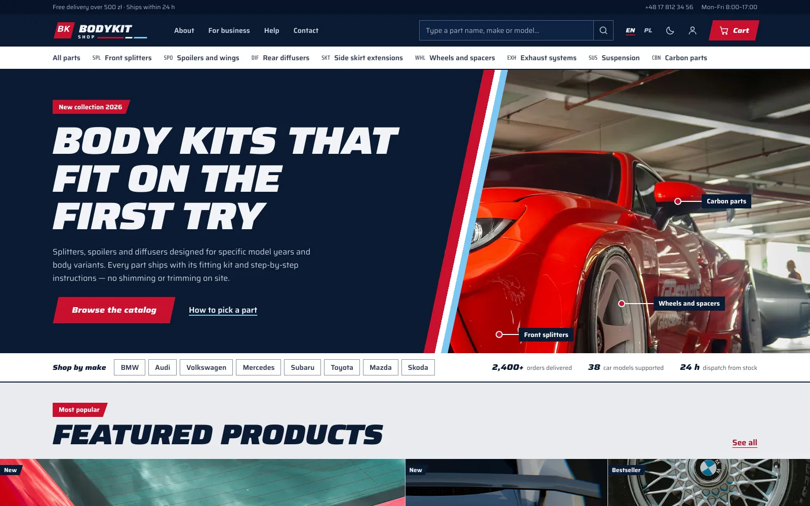
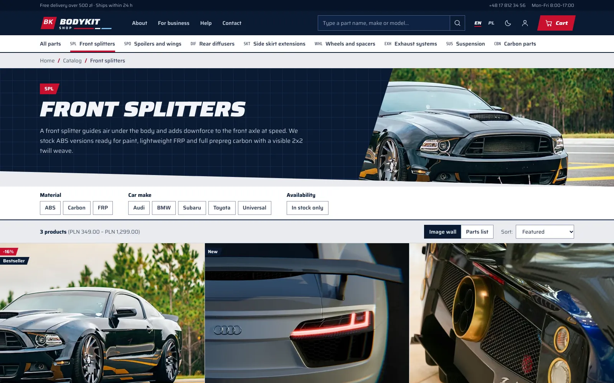
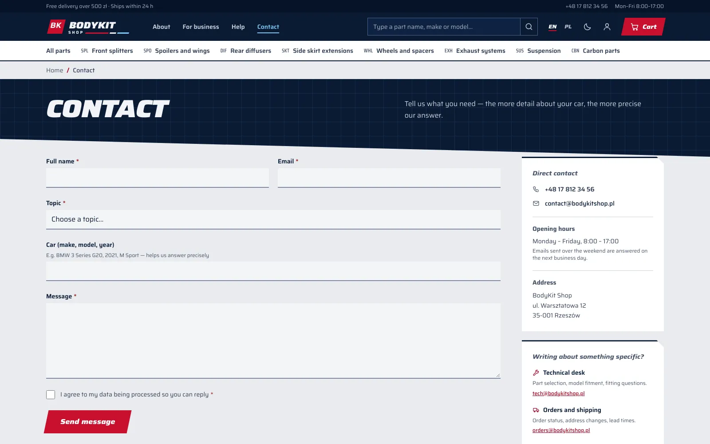

<p align="center">
  <a href="https://bodykit.dawidolko.pl/"></a>
</p>

# BodyKit Shop

> 🚀 **A front-end shop for car body kits and styling parts** - a complete bilingual storefront that compiles to static HTML

**BodyKit Shop** is a complete front-end store selling body modification parts: front splitters, spoilers, diffusers, wheels and carbon fibre components. There is no backend — the whole thing compiles to static HTML that can be hosted on GitHub Pages, any CDN, or behind nginx in a container.

Cart state lives in `localStorage`, the catalog is compiled into the bundle, and every page is generated at build time in both languages. The project demonstrates a production-grade static Next.js setup: prefixed locale routes, a build-time image pipeline, a documented design system and an accessibility audit wired into CI.


**[Live site](https://bodykit.dawidolko.pl/)** · [Screenshots](#️-screenshots) · [Getting started](#-getting-started)

---

## 🎯 Key Features

- 🌐 **Bilingual** — English and Polish, each with its own URL prefix, `hreflang` pairs and a switcher that keeps you on the same page
- 🛍️ **Full catalog** — 17 routes × 8 categories × 19 products, generated statically per locale
- 🛒 **Cart & checkout** — Cart state persisted in `localStorage`, with a full checkout flow and validation that runs entirely in the browser
- 🌗 **Themes** — Light and dark, with a toggle, persisted choice and system preference detection
- ♿ **Accessibility** — WCAG 2.2 AA, zero axe-core violations across every route in both locales and both themes
- 🔎 **SEO** — Per-page metadata, `sitemap.xml` with language alternates, `robots.txt`, JSON-LD (Organization, WebSite, ItemList, FAQ, BreadcrumbList)
- 🖼️ **Images** — AVIF + WebP at three widths, LQIP placeholders, `srcset` driven by a build-time manifest
- ⚡ **Performance** — Self-hosted fonts, no third-party requests, a 1920 px hero at 112 kB in AVIF
- 🎨 **Design system** — A parts-catalogue identity with a documented style guide route covering tokens, colour contrast and components
- ✅ **Quality** — TypeScript `strict`, ESLint, Prettier and an accessibility audit in CI

---

## 🖼️ Screenshots

| Desktop                                                                                                           | Phone                                                                                              |
| ----------------------------------------------------------------------------------------------------------------- | -------------------------------------------------------------------------------------------------- |
|  |  |

| Home page                                                                                 | Shop                                                                                |
| ----------------------------------------------------------------------------------------- | ----------------------------------------------------------------------------------- |
|  |  |

| Contact                                                                                     |     |
| ------------------------------------------------------------------------------------------- | --- |
|  |     |

---

## 🧩 Modules

| Module             | Description                                                                 | Stack                                          |
| ------------------ | --------------------------------------------------------------------------- | ---------------------------------------------- |
| **Catalog**        | Products, categories and localized content in the data layer                | `src/lib/products.ts`, `src/lib/categories.ts` |
| **Cart**           | Client-side cart state persisted to `localStorage`                          | `src/lib/cart.tsx`                             |
| **Product UI**     | Card, gallery, filters and add-to-cart                                      | `src/components/product`                       |
| **Checkout**       | Multi-field checkout with full validation, no network calls                 | `src/components/checkout`                      |
| **SEO**            | Structured data for Organization, WebSite, ItemList, FAQ and BreadcrumbList | `src/components/seo`                           |
| **i18n**           | Locale config, dictionaries and the language switcher                       | `src/i18n`                                     |
| **Image pipeline** | Fetch, crop, convert and manifest generation                                | `scripts/`, `src/lib/image-manifest.json`      |

---

## 🛠️ Technology Stack

### Frontend

- **Next.js 16** — App Router with a full static export
- **React 19** — Server and Client Components
- **TypeScript 5.7** — `strict` mode
- **Tailwind CSS 4** — CSS-based configuration via `@tailwindcss/postcss`
- **next/font** — Saira wide italic and Saira text, self-hosted WOFF2 subsets with Polish glyphs

### Tooling & Quality

- **ESLint 9** with `eslint-config-next`
- **Prettier 3**
- **axe-core** via `scripts/a11y-audit.mjs`
- **sharp** for the AVIF/WebP image pipeline

### Infrastructure

- **GitHub Actions** — Pages deployment plus a separate quality workflow
- **GitHub Pages** — static hosting on a custom domain via `public/CNAME`
- **Docker** — multi-stage build, nginx runtime (`.tools/docker/`)
- **Node.js ≥ 20.9** (22 recommended)

---

## 🚀 Getting Started

### Prerequisites

- **Node.js 20.9 or newer** (22 recommended)
- **npm**
- Optionally **Docker** for the containerised runtime

### 1. Clone the Repository

```bash
git clone https://github.com/dawidolko/BodyKit-Shop-Frontend-NextJS.git
cd BodyKit-Shop-Frontend-NextJS
```

### 2. Install Dependencies

```bash
npm install
```

### 3. Run

```bash
npm run dev
```

The app starts at [http://localhost:3000](http://localhost:3000) and redirects to `/en/`.

Production build:

```bash
npm run build     # static export into out/
npm run serve     # preview the built output on :3000
```

### Available Scripts

| Command                             | Purpose                                 |
| ----------------------------------- | --------------------------------------- |
| `npm run dev`                       | Development server                      |
| `npm run build`                     | Static export into `out/`               |
| `npm run serve`                     | Preview the built output                |
| `npm run verify`                    | Types + lint + format + build           |
| `npm run typecheck`                 | TypeScript only                         |
| `npm run lint` / `lint:fix`         | ESLint                                  |
| `npm run format` / `format:check`   | Prettier                                |
| `npm run audit:a11y`                | axe-core audit (needs a running server) |
| `npm run images:fetch`              | Download photo sources                  |
| `npm run images:optimize`           | Optimize images and write the manifest  |
| `npm run brand:assets`              | Favicons and Open Graph card            |
| `npm run docker:build`              | Build the Docker image                  |
| `npm run docker:up` / `docker:down` | Docker Compose                          |

---

## 🌐 Internationalisation

Every page lives under a locale segment: `/en/products/gt-wing-1400/` and `/pl/products/gt-wing-1400/`. English is the default.

**Why separate paths rather than a client-side toggle.** A static export has no server to negotiate languages, so a runtime switch would leave search engines seeing a single language and would flash the wrong copy on first paint. Prefixed routes give each language a real, indexable URL, work without JavaScript, and let `hreflang` pair the two versions properly.

**URL slugs stay English in both languages.** `/pl/products/carbon-mirror-caps/` rather than `/pl/produkty/nakladki-lusterek/`. One set of slugs means links, `generateStaticParams` and the language switcher never need a translation table — swapping the locale segment is enough to land on the same page.

### Where the strings live

```
src/i18n/
├── config.ts               # locales, localePath(), switchLocaleInPath()
├── index.ts                # getDictionary()
└── dictionaries/
    ├── en.ts               # source of truth; its shape defines the contract
    └── pl.ts               # typed against en.ts
```

`pl.ts` is typed as `Dictionary`, a widened version of the English object. Add a key to `en.ts` and the Polish file fails to compile until it catches up — a missing translation is a build error, not a silent English fallback.

Product and category content is bilingual in the data layer itself: text fields are `Localized<T>` (`{ en, pl }`) and are read through `t(field, locale)`.

Plural rules that Polish needs and English does not are handled inside the dictionary, as functions: `dict.product.reviews(3)` returns `3 reviews` or `3 opinie` depending on the locale.

### Adding a language

1. Add the code to `locales` in `src/i18n/config.ts` and fill in `localeNames`, `localeTags`, `ogLocales`.
2. Create `src/i18n/dictionaries/<code>.ts` typed as `Dictionary`.
3. Add the language key to every `Localized` field in `categories.ts` and `products.ts`.

TypeScript will point at each spot that still needs attention.

---

## 🎨 Design System

The site is drawn as a **tuning-garage parts catalogue**, not a marketing page. It takes its language from race livery and workshop paperwork: primer-grey sheets, navy bands, racing red, a sky stripe, wide italic display type and one 12 degree lean shared by the logo, the buttons, the hero plate and the section cuts. Hazard tape appears only on the footer's start line and on low-stock tags.

How that shows up in the structure:

- **Header** — a sticky navy row with a real search field and a cart plate, plus a catalog index that keeps all eight categories one click away.
- **Home** — the hero photo carries part callouts like an exploded diagram, then the page goes straight to a gapless parts wall, a category mosaic and a fitting procedure table.
- **Catalog** — filter chips across the full width, with a switch between the image wall and a parts list. Every part has a catalogue number, such as `BK-SPL-001`, built from its category code.
- **Product** — the gallery runs edge to edge, and fitment is a proper table of make, model and years.
- **Checkout and footer** — numbered sheet tabs for the checkout steps, and a footer ruled like the title block of an engineering drawing.

### Colour

| Role           | Light                        | Dark                  |
| -------------- | ---------------------------- | --------------------- |
| Primary text   | `carbon-950` — 14.5:1        | `carbon-50` — 17.4:1  |
| Secondary text | `carbon-700` — 8.6:1         | `carbon-200` — 12.7:1 |
| Muted text     | `carbon-600` — 6.4:1         | `carbon-300` — 9.1:1  |
| Link / accent  | `brand-700` — 6.7:1          | `sky` — 10.4:1        |
| Text on accent | white on `brand-600` — 5.9:1 | same pair             |

The light theme sits on primer grey with white sheets on top. The dark theme is a blueprint: deep navy, with sky blue taking over links and accents because red text on navy would not reach 4.5:1. Bands marked `.livery` stay navy in both themes and carry their own text, border and focus tokens.

Every value was computed and then confirmed by an axe-core scan.

### Typography

Saira carries everything: wide italic (700–900) for headings and prices, upright (400–700) for body text, and condensed with lining figures and a slashed zero for part numbers. Both files are WOFF2 subsets covering Latin and Polish, 19 kB and 39 kB, stored in `src/fonts` under the SIL Open Font License and loaded through `next/font/local`. Only the display face is preloaded, and nothing is requested from a third party.

Full token and component documentation: [`/en/style-guide`](https://bodykit.dawidolko.pl/en/style-guide/).

---

## ♿ Accessibility

The project passes an axe-core audit (WCAG 2.2 A/AA plus best practices) with **zero violations** across every route, in both locales and both themes.

```bash
npm run build
npx serve out -l 4321 &
npm run audit:a11y
```

What that covers in practice:

- **Contrast** — every text/background pair at 4.5:1 or better, UI elements at 3:1, in both themes.
- **Focus** — one shared `.focus-ring` class, a 2 px ring with a 2 px offset, shown only for `:focus-visible`. Buttons lean with a skew rather than a clip, so the ring is never cut off.
- **Keyboard** — skip link, `Escape` closes panels and restores focus, disclosures expose `aria-expanded`.
- **Forms** — labels bound to controls, errors announced through `role="alert"`, and a failed submit moves focus to a summary that links to each broken field.
- **Language** — `<html lang>` matches the rendered locale, and `hreflang` links pair the two versions.

- **Motion** — `prefers-reduced-motion` collapses every animation to 0.01 ms.
- **High contrast** — `prefers-contrast: more` strengthens borders and muted text.
- **Structure** — one `h1` per page and no skipped heading levels (`ProductCard` takes its level from context).

An accessibility panel in the corner of every page changes text size, contrast, font and motion, and remembers the choice on the device. It sits on top of the markup and does not replace accessible markup.

---

## 🖼️ Images

Photographs come from [Unsplash](https://unsplash.com) under a licence that permits commercial use. Credits: [`public/images/CREDITS.md`](public/images/CREDITS.md).

```bash
npm run images:fetch      # downloads sources into .image-cache/ (git-ignored)
npm run images:optimize   # crops, converts and writes the manifest
```

Cropping uses sharp's `attention` strategy, which picks the most salient region instead of a blind centre crop — it matters because several sources are portrait while the layout needs panoramas. The script emits AVIF and WebP at three widths, an LQIP placeholder, and `src/lib/image-manifest.json`.

The `Picture` component reads only from that manifest, so a `srcset` can never point at a variant that is missing from disk — a mistake that would otherwise surface as a 404 in the browser rather than at build time.

---

## 📁 Project Structure

```
BodyKit-Shop-Frontend-NextJS/
├── .github/workflows/     # Pages deployment + quality checks
├── .tools/docker/         # Dockerfile, compose, nginx configuration
├── docs/screenshots/      # README imagery
├── public/
│   ├── images/            # AVIF/WebP variants + CREDITS.md
│   └── CNAME, favicon.svg, og-default.png, site.webmanifest
├── scripts/
│   ├── fetch-images.mjs           # downloads photo sources from Unsplash
│   ├── optimize-images.mjs        # crops, converts, writes the manifest
│   ├── generate-brand-assets.mjs  # favicons and the Open Graph card
│   └── a11y-audit.mjs             # axe-core audit across both locales
└── src/
    ├── app/
    │   ├── page.tsx       # language redirect stub at the root
    │   ├── robots.ts
    │   ├── sitemap.ts
    │   └── [locale]/      # every real route: products, categories, cart,
    │                      # checkout, search, account, business, packages,
    │                      # help, contact, about, terms, style-guide
    ├── components/
    │   ├── brand/         # logo
    │   ├── cart/          # cart UI
    │   ├── checkout/      # checkout flow
    │   ├── contact/       # contact form
    │   ├── home/          # home page sections
    │   ├── layout/        # header, footer, theme and language switchers
    │   ├── product/       # card, gallery, filters, add-to-cart
    │   ├── search/        # search UI
    │   ├── seo/           # structured data
    │   └── ui/            # buttons, fields, badges, icons, images
    ├── i18n/              # locale config and dictionaries
    └── lib/               # catalog, types, cart state, image manifest, helpers
```

---

## 🐳 Running with Docker

The image is multi-stage: Node builds the static export, nginx serves it. The final layer contains neither Node nor any dependencies.

```bash
# Production on http://localhost:8080
npm run docker:up

# or without compose
docker build -f .tools/docker/Dockerfile -t bodykit-shop .
docker run -p 8080:8080 bodykit-shop

# Development with hot reload on http://localhost:3000
docker compose -f .tools/docker/docker-compose.yml --profile dev up
```

The container runs as an unprivileged user with a read-only filesystem and sends a full set of security headers (CSP, `X-Content-Type-Options`, `X-Frame-Options`, `Referrer-Policy`, `Permissions-Policy`).

> **A note on nginx:** the security headers live in a snippet that is included in every `location` block. That is not decoration — nginx only inherits `add_header` into blocks that declare none of their own, so a single `add_header` inside a `location` silently drops every server-level header.

---

## 🚢 Deploying to GitHub Pages

The site runs on a custom domain: **[bodykit.dawidolko.pl](https://bodykit.dawidolko.pl/)**.

### GitHub configuration

1. **Settings → Pages → Source: GitHub Actions**.
2. **Settings → Pages → Custom domain**: `bodykit.dawidolko.pl`, then tick **Enforce HTTPS**.

[`public/CNAME`](public/CNAME) is copied into the build output, so the domain setting survives every deployment. The workflow verifies the file is present and fails the build if it is missing.

### DNS

Add this record for `dawidolko.pl`:

| Type    | Name      | Value                  |
| ------- | --------- | ---------------------- |
| `CNAME` | `bodykit` | `dawidolko.github.io.` |

Propagation usually takes a few minutes. "Enforce HTTPS" stays greyed out until the certificate is issued.

### Builds

Every push to `main` builds and deploys. Because the site is served from the root of a custom domain, `basePath` stays empty. The workflow also writes `.nojekyll`, without which Pages would hide the `_next` directory.

Reproducing the production build locally:

```bash
NEXT_PUBLIC_SITE_URL=https://bodykit.dawidolko.pl npm run build
```

If you ever drop the custom domain and go back to `<user>.github.io/<repo>`, set `NEXT_PUBLIC_BASE_PATH` to `/<repository-name>` in `deploy.yml` and delete `public/CNAME`.

A second workflow (`quality.yml`) checks types, linting and formatting, runs the accessibility audit, and verifies that the Docker image builds and serves its routes and headers correctly.

---

## 📝 Notes

This is a **demonstration project**. Orders are not fulfilled, no payments are taken, and no form sends data anywhere — validation runs in full, but the result stays in the browser. The terms and privacy policy were written for a mock-up and are not a contractual template.

The catalog, technical descriptions and company details are fictional.

---

## 📄 License

This project is open source and available under the [MIT License](LICENSE).

---

## 👨‍💻 Author

**Dawid Olko** · Fullstack / AI Developer

[Portfolio](https://olkodawid.dawidolko.pl) · [CV](https://cv.dawidolko.pl) · [LinkedIn](https://www.linkedin.com/in/dawidolko/) · [GitHub](https://github.com/dawidolko)
